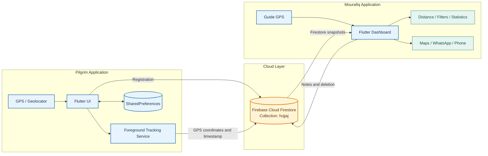
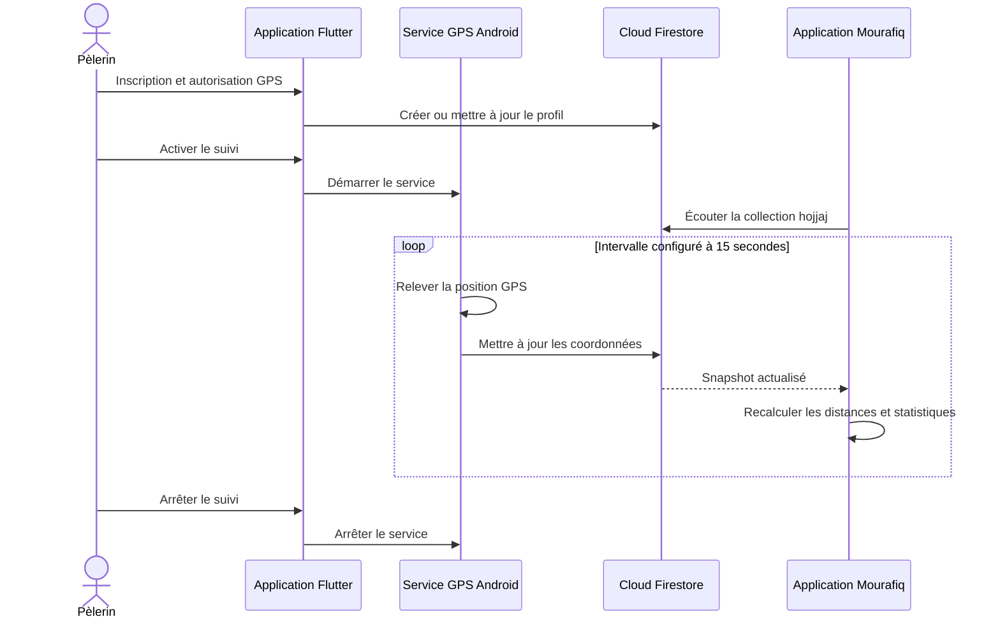
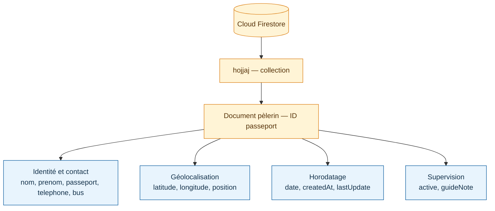

<div align="center">

# Hajj Pilgrim Tracking

**Suivi GPS des pèlerins & supervision des groupes par les guides (Mourafiq)**

Une solution mobile composée de deux applications Flutter connectées à Firebase Cloud Firestore, conçue pour faciliter l'accompagnement des pèlerins pendant le Hajj.

<p>
  <a href="https://flutter.dev/"></a>&nbsp;&nbsp;&nbsp;
  <a href="https://dart.dev/"></a>&nbsp;&nbsp;&nbsp;
  <a href="https://firebase.google.com/"></a>&nbsp;&nbsp;&nbsp;
  <a href="https://developer.android.com/"></a>
</p>
<p>
  
  
  
  
  
</p>

[Présentation](#présentation) · [Fonctionnalités](#fonctionnalités) · [Architecture](#architecture) · [Stack](#stack-technologique) · [Installation](#installation) · [Sécurité](#sécurité-et-confidentialité)

</div>

---

## Présentation

Lors du Hajj, la coordination de groupes de pèlerins dans des zones très fréquentées représente un défi pour les guides. **Hajj Pilgrim Tracking** propose un système de géolocalisation et de supervision qui permet aux pèlerins de partager leur position et aux guides de visualiser leur dernière position enregistrée, leur distance et leur groupe de transport.

| Application pèlerin | Application Mourafiq (guide) |
| :--- | :--- |
| Inscription et partage de position GPS | Tableau de bord et supervision |
| Démarrage et arrêt du suivi par l'utilisateur | Classification par distance et statistiques par bus |
| `app_utilisateur/` | `app_admin/` |

## Fonctionnalités

### Application pèlerin

- Inscription avec nom, prénom, passeport, téléphone et numéro de bus.
- Récupération de la position GPS avec gestion des autorisations de localisation.
- Synchronisation des informations et des coordonnées avec Cloud Firestore.
- Service Android de suivi en arrière-plan, avec notification persistante et intervalle configuré à **15 secondes** (la fréquence effective dépend du GPS, du réseau et du système).
- Démarrage et arrêt du suivi depuis l'interface utilisateur.
- Conservation de la session locale avec `SharedPreferences`.
- Ouverture de la position affichée dans Google Maps.

### Application Mourafiq — Guide

- Tableau de bord réactif alimenté par les flux Firestore (`snapshots()`).
- Calcul de la distance entre la position relevée du guide et celle de chaque pèlerin.
- Recherche par nom, prénom, téléphone ou bus et filtrage selon la distance.
- Statistiques globales et répartition des pèlerins par bus.
- Consultation des informations individuelles et ajout de notes par le guide.
- Accès rapide à l'appel téléphonique, à WhatsApp et à Google Maps.
- Suppression manuelle d'un dossier avec confirmation ; l'interface bloque la suppression si une mise à jour connue date de moins de 24 heures.

### Classification par distance

| Statut | Distance par rapport au guide (seuils par défaut) |
| :--- | :--- |
| Proche | ≤ 100 m |
| Éloigné | > 100 m et ≤ 500 m |
| Très éloigné | > 500 m |

Les deux seuils sont modifiables dans le tableau de bord. Ils sont partagés entre les écrans de l'application guide via le singleton `DistanceThresholds`. Ils ne constituent pas un dispositif d'alerte d'urgence.

## Architecture

L'architecture s'appuie sur deux clients mobiles et une base de données cloud partagée. Le pèlerin transmet ses coordonnées ; le guide écoute les modifications de la collection `hojjaj` et calcule localement les distances à partir de sa propre position.



### Flux de données

1. Le pèlerin s'inscrit et autorise l'accès à sa localisation.
2. L'application crée ou met à jour son document dans Firestore.
3. Lorsque le suivi est activé, le service récupère périodiquement les coordonnées GPS et actualise le document.
4. L'application guide reçoit les modifications via un flux Firestore.
5. Les distances, catégories et statistiques sont calculées localement puis affichées dans l'interface.

### Diagramme de séquence — Synchronisation GPS



## Stack technologique

| Technologie | Rôle |
| :--- | :--- |
|  **Flutter** | Interfaces mobiles des deux applications |
|  **Dart** | Logique applicative |
|  **Firebase Core** | Initialisation des services Firebase |
|  **Cloud Firestore** | Stockage des profils et synchronisation des positions |
|  | Acquisition GPS et calcul de distance |
| **Flutter Foreground Task** | Exécution du service de suivi Android |
| **SharedPreferences** | Persistance de la session locale |
| **URL Launcher** | Ouverture des applications externes et liens |
|  **Android / Gradle** | Configuration et compilation natives |

## Modèle de données

Les applications utilisent la collection Firestore `hojjaj`. Chaque document est actuellement identifié par le numéro de passeport du pèlerin.



| Champ | Type | Description |
| :--- | :--- | :--- |
| `nom`, `prenom` | String | Identité |
| `passeport` | String | Numéro de passeport et identifiant actuel |
| `telephone`, `bus` | String | Contact et groupe de transport |
| `latitude`, `longitude` | Number | Dernières coordonnées enregistrées |
| `position` | GeoPoint | Position au format Firestore |
| `date` | String | Date ISO 8601 produite par le client |
| `createdAt`, `lastUpdate` | Timestamp | Horodatages serveur |
| `active` | Boolean | Indicateur de visibilité utilisé par le guide (pas un indicateur fiable de suivi en direct) |
| `guideNote` | String (facultatif) | Note ajoutée par le guide |

Le suivi actualise le même document avec une écriture fusionnée (`SetOptions(merge: true)`) ; il ne conserve pas un historique complet des trajectoires.

## Structure du projet

```text
hajj-pilgrim-tracking/
├── app_utilisateur/
│   ├── android/                  # Configuration Android
│   ├── lib/
│   │   ├── main.dart             # Initialisation et restauration de session
│   │   ├── inscription_page.dart # Inscription et écran de suivi
│   │   ├── session_manager.dart  # Persistance locale
│   │   └── tracking_service.dart # Service de géolocalisation
│   ├── test/
│   └── pubspec.yaml
├── app_admin/
│   ├── android/
│   ├── lib/
│   │   ├── main.dart             # Point d'entrée
│   │   ├── admin_dashboard.dart  # Liste, filtres et détails des pèlerins
│   │   ├── stats_page.dart       # Statistiques et seuils de distance
│   │   ├── distance_thresholds.dart
│   │   └── splash_page.dart
│   ├── test/
│   └── pubspec.yaml
├── .gitignore
└── README.md
```

## Installation

### 1. Prérequis

- Flutter SDK incluant Dart compatible avec la contrainte `^3.8.1`.
- Android Studio ou VS Code avec les extensions Flutter et Dart.
- Android SDK 35 (Android 6.0 / API 23 minimum pour les appareils).
- Android NDK `27.0.12077973` pour l'application pèlerin.
- Un appareil Android ou un émulateur avec localisation configurée.
- Un projet Firebase avec Cloud Firestore activé et des règles d'accès adaptées.

Vérifier l'environnement :

```bash
flutter doctor
flutter devices
```

### 2. Récupérer le projet

Cloner le dépôt depuis GitHub ou extraire l'archive, puis ouvrir un terminal à sa racine. Les commandes suivantes supposent que le terminal se trouve dans le dossier qui contient `app_utilisateur/` et `app_admin/`.

### 3. Configurer Firebase

1. Créer un projet dans la [console Firebase](https://console.firebase.google.com/).
2. Activer Cloud Firestore dans ce projet.
3. Enregistrer les applications Android avec les identifiants correspondant à leurs configurations Gradle.
4. Télécharger le fichier `google-services.json` approprié pour chaque application et le placer ici :

```text
app_utilisateur/android/app/google-services.json
app_admin/android/app/google-services.json
```

> [!IMPORTANT]
> Les deux applications déclarent actuellement `com.example.mobile` comme `applicationId`. Pour les installer simultanément sur le même appareil, attribuer un identifiant Android distinct à l'une des applications, adapter les configurations Android/Firebase correspondantes et télécharger son nouveau fichier de configuration. Les deux clients doivent rester connectés au même projet Firestore.

Les fichiers de configuration Firebase sont exclus du dépôt par `.gitignore`. Ne jamais utiliser de règles Firestore publiques pour de vraies données de pèlerins.

### 4. Lancer l'application pèlerin

Depuis la racine :

```bash
cd app_utilisateur
flutter pub get
flutter run
```

Autoriser la localisation et les notifications, puis utiliser des données fictives pour tester l'inscription et le suivi.

### 5. Lancer l'application guide

Dans un second terminal, depuis la racine :

```bash
cd app_admin
flutter pub get
flutter run
```

Autoriser la localisation du guide afin d'activer le calcul des distances. Pour tester les deux applications sans modifier les identifiants Android, utiliser deux appareils ou émulateurs distincts.

### 6. Générer un APK

Dans le dossier de l'application souhaitée :

```bash
flutter build apk --release
```

Le fichier est normalement généré dans `build/app/outputs/flutter-apk/app-release.apk`. La configuration Gradle actuelle utilise la clé de signature debug pour le build release : prévoir une signature dédiée avant distribution.

## Validation fonctionnelle

Scénario de test proposé après configuration de Firebase et des autorisations :

| Étape | Résultat attendu |
| :--- | :--- |
| Inscrire un pèlerin fictif | Création ou mise à jour d'un document `hojjaj` |
| Activer le suivi | Notification de suivi et actualisation de `lastUpdate` lorsque les écritures réussissent |
| Ouvrir l'application guide | Affichage du profil et des coordonnées reçues |
| Simuler un déplacement | Actualisation de la position et de la distance calculée |
| Modifier les seuils | Mise à jour des catégories de distance |
| Ajouter une note | Persistance de `guideNote` dans Firestore |
| Arrêter le suivi | Arrêt du service périodique ; la dernière position reste enregistrée |

Pour analyser le code, exécuter `flutter analyze` dans chaque application. Les dossiers `test/` existent, mais aucune couverture des scénarios ci-dessus ni exécution réussie n'est attestée ici.

## Aperçu des interfaces

| Application pèlerin | Application Mourafiq |
| :--- | :--- |
| Formulaire d'inscription et écran de suivi | Statistiques globales, liste des pèlerins et fiche détaillée |

<!-- Pour ajouter vos captures réelles : créez docs/screenshots/ à la racine,
     puis ajoutez les fichiers et décommentez le tableau ci-dessous.
     Masquez tout nom, téléphone, passeport et emplacement réel avant publication.

<div align="center">
  
  
  
</div>

-->

## Sécurité et confidentialité

Le projet manipule des informations personnelles et des données de géolocalisation sensibles. La session locale actuelle n'est pas une authentification Firebase, et les règles Firestore du projet cloud ne sont pas incluses dans le dépôt. Avant toute utilisation réelle, les évolutions suivantes sont nécessaires :

- Ajouter Firebase Authentication et une gestion des rôles pèlerin/guide avec des règles Firestore restrictives et testées.
- Remplacer le numéro de passeport comme identifiant de document par un identifiant opaque et minimiser la collecte de données personnelles.
- Recueillir un consentement explicite au partage de position et définir une durée de conservation et un mécanisme de suppression.
- Distinguer l'état du service de suivi de la simple visibilité du profil, et signaler les positions anciennes ou indisponibles.
- Tester le comportement hors connexion, les restrictions Android et la consommation énergétique.

> Ce projet ne doit pas être considéré comme un système de sécurité ou de secours certifié. Une position affichée peut être ancienne ou indisponible.

## Perspectives d'évolution

- Authentification et autorisations par rôle.
- Carte interactive intégrée pour visualiser les groupes.
- Notifications de franchissement de seuil et indication de fraîcheur des positions.
- Historique des déplacements avec politique de conservation.
- Tests automatisés et intégration continue avec GitHub Actions.

## Contribution

Les améliorations peuvent être proposées via une issue ou une pull request. Aucune licence explicite n'est actuellement incluse dans le dépôt ; vérifier les droits applicables avant toute réutilisation ou redistribution.

---

<div align="center">

**Hajj Pilgrim Tracking** · Mobile Development · GPS Tracking · Cloud Synchronization

<sub>Built with Flutter, Dart & Firebase.</sub>

</div>
